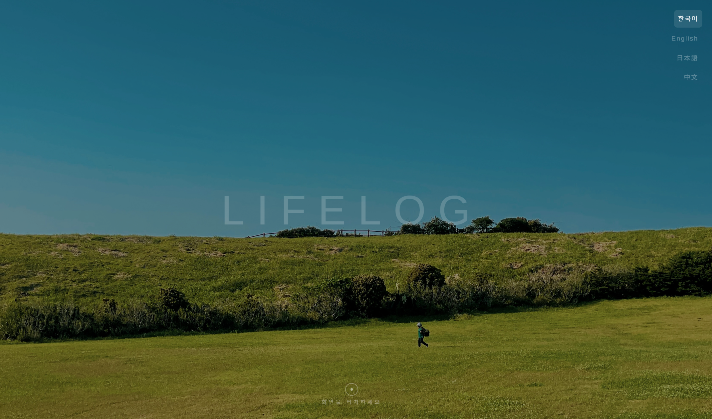

# LIFELOG

촬영 순간의 날짜·위치·날씨·감정을 사진과 문구로 남기는 AI 포토부스 프로젝트입니다. JEJU-LOG에서 촬영 경험과 적용 범위를 확장했습니다.



## 구현 내용

- 촬영·사진 선택과 키오스크 화면 흐름
- 사진과 촬영 맥락을 이용한 문구·해시태그 생성
- 결과 이미지 구성, 저장·출력 준비
- React 화면과 Django API 연동

## 구성

**React · Vite · Python · Django REST Framework · AI API · AWS**

`frontend/`는 촬영·결과 화면, `backend/`는 API와 이미지·문구 처리를 담당합니다.

## 로컬 개발

```bash
npm ci
python -m pip install -r backend/requirements.txt
npm run dev
```

백엔드 환경 변수와 AI 서비스 인증은 로컬에서 설정합니다.

## 프로젝트 기록

교육 프로젝트로 진행했으며 개인 상용 앱의 운영 성과와 구분합니다. 기존 구현 설명과 화면은 [개발 배경·구현 기록](docs/project-background.md)에 보관했습니다.

[전체 포트폴리오](https://github.com/kimth1113/portfolio) · [이전 JEJU-LOG](https://github.com/kimth1113/JEJU-LOG)
